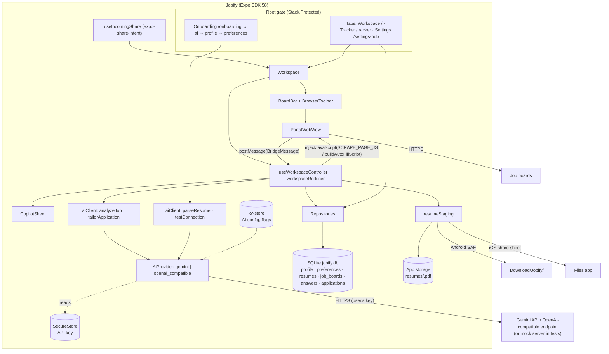
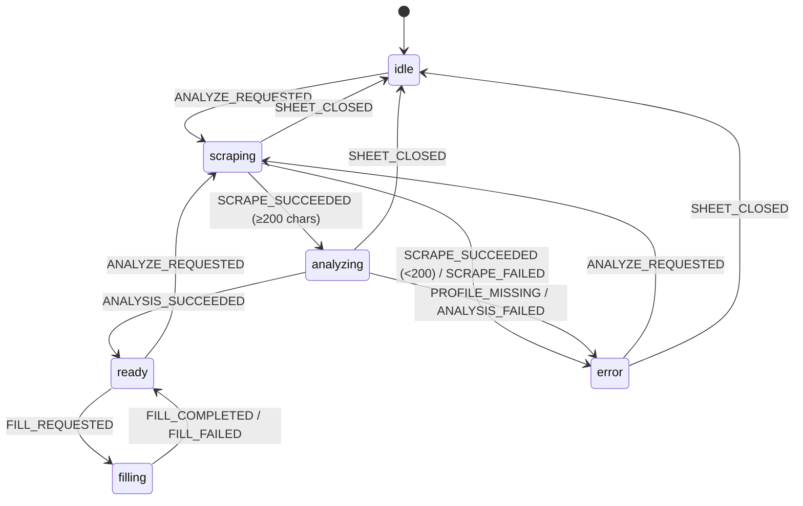

# ARCHITECTURE.md: Jobify v1

Local-first job-application companion. One persistent WebView shows job boards. A bring-your-own-key AI copilot reads the open job page, checks fit and red flags, picks a resume, and fills the form. A SQLite tracker logs applications with follow-ups and insights.

Read with: `PRODUCT_SPEC.md` (what), `PLAN_REVIEW.md` (decisions A-xx), `UI_DIRECTIVES.md` (look and states), `TASKS.md` (order), `TEST_PLAN.md`, `FUTURE.md` (not v1).

---

## 1. Stack

**React Native + Expo SDK 58 + TypeScript.**
1. Platforms: Android first plus iOS from one codebase.
2. Native needs: WebView with JS injection, SQLite, secure storage, SAF file writes, document picker, share intent, clipboard, and haptics. All of these are first-party Expo modules or MIT/Apache libraries, with no custom native code.
3. Offline: the tracker, settings, and backup work offline. Only the AI and job sites need the network.
4. Agent reliability: SDK-pinned versions, `expo-doctor`, and TypeScript contracts.
5. F-Droid: every dependency is free software, with no Google Play Services or Firebase (verified in T-049).

### 1.1 Pinned versions (exact, `package.json`; SDK 58 compatible; `expo-doctor` 20/20 on 2026-10-22)

| Package | Version | Purpose |
|---|---|---|
| expo | 58.0.17 | SDK |
| react / react-dom | 19.3.0 | React (react-dom only satisfies router peers) |
| react-native | 0.88.0 | RN |
| typescript | 6.0.3 | Types |
| expo-router | 58.0.25 | Navigation, deep links, `Stack.Protected` gate |
| expo-sqlite | 58.0.13 | DB + `expo-sqlite/kv-store` |
| expo-secure-store | 58.0.2 | API key (Keystore/Keychain) |
| expo-file-system | 58.0.10 | App storage (`File`, `Paths`) + SAF (`expo-file-system/legacy`) |
| expo-document-picker | 58.0.4 | Pick resume PDF / backup JSON |
| expo-share-intent | 9.0.0 | Android "Share to Jobify" (MIT, community) |
| expo-localization | 58.0.5 | Default time zone / region |
| expo-sharing | 58.0.20 | iOS resume share, backup export |
| expo-clipboard | 58.0.4 | Copy cover note / DM |
| expo-haptics | 58.0.7 | Feedback |
| expo-asset | 58.0.18 | App assets |
| expo-linking / expo-constants | 58.0.14 / 58.0.13 | External links, version, repo URL |
| expo-status-bar / expo-system-ui / expo-splash-screen | 58.0.4 / 58.0.6 / 58.0.11 | Chrome |
| react-native-webview | 14.0.1 | Job board browser |
| @gorhom/bottom-sheet | 5.2.14 | Copilot sheet (A-28) |
| react-native-reanimated / react-native-worklets | 4.7.1 / 0.13.0 | Animations |
| react-native-gesture-handler | 3.3.0 | Gestures |
| react-native-safe-area-context / react-native-screens | 5.10.1 / 4.30.0 | Layout / navigation |
| react-native-svg / lucide-react-native | 15.16.0 / 1.61.0 | Icons |
| **dev:** jest / jest-expo / @react-native/jest-preset | 30.5.2 / 58.0.12 / 0.88.0 | Tests |
| @testing-library/react-native / test-renderer | 14.1.0 / 1.3.1 | Component tests |
| @types/jest / @types/react | 30.0.0 / 19.3.0 | Types |
| eslint / eslint-config-expo | 9.39.5 / 58.0.4 | Lint |

Toolchain: Node 22.x, npm 10.x, JDK 17 or 21, Android SDK Platform 37 + Build-Tools 37.0.0 (Gradle installs them on first build), Maestro CLI 2.11.0. **Not used (F-Droid):** `expo-notifications` (pulls `firebase-messaging`), `expo-updates`/EAS Update, any analytics SDK.

---

## 2. System diagram



---

## 3. Data model

### 3.1 Remote
There is no backend. The remote calls are the AI provider (§5) and the job sites (opaque pages).

### 3.2 SQLite `jobify.db` (source of truth: `src/db/schema.ts`)
Versioned with `PRAGMA user_version` (`DB_VERSION = 1`). `PRAGMA foreign_keys = ON`. Tables:

| Table | Key columns | Notes |
|---|---|---|
| `profile` | `id = 1`, `data_json` (CandidateProfile) | Single row. Read through `normalizeProfile`. |
| `preferences` | `id = 1`, `data_json` (JobPreferences) | Single row. Read through `normalizePreferences`. |
| `resumes` | `id`, `label` UNIQUE NOCASE, `file_name`, `file_uri`, `content_json` (ResumeContent) | PDF copy at `documentDirectory/resumes/<id>.pdf`. |
| `job_boards` | `id`, `name`, `url`, `last_visited_url`, `sort_order` | Seeded once from `SEED_BOARDS`. |
| `answers` | `id`, `question`, `answer`, `use_count`, `updated_at` | Answer bank. |
| `applications` | `id`, `company_name`, `role_title`, `board_name`, `job_url` UNIQUE, `resume_id` FK→resumes ON DELETE SET NULL, `resume_label`, `match_score`, `eligibility` CHECK, `red_flags_json`, `cover_note`, `cold_dm`, `notes`, `status` CHECK, `follow_up_at`, `created_at`, `status_changed_at` | Tracker. |

Enums and CHECKs are listed in `src/types/domain.ts`. `tests/contracts` keeps them in sync with the schema and AI schemas. Unknown enum values in a row are skipped by repositories, never crash.

### 3.3 kv-store keys (`src/services/kvStore.ts`)
`onboardingCompleted`, `aiProvider`, `aiModel`, `aiBaseUrl`, `activeBoardId`, `androidStagingDirUri`, `stagingExplainerSeen`.

### 3.4 Secure store (`src/services/secrets.ts`)
`jobify.ai.apiKey`, and nothing else.

### 3.5 In memory only
`AnalysisSession` (including `pageText`) and `TailorState` live in the workspace reducer. They are lost on restart or context change (A-22).

---

## 4. Configuration
There are no build-time secrets or env files. All AI configuration is entered in the app. `app.json` `extra.repositoryUrl` is shown in About.

---

## 5. AI contract (`src/services/ai/*`)

### 5.1 Calls
| Call | Function | Schema (`schemas.ts`) | Validator (`validate.ts`) | Timeout | Prompt (`prompts.ts`) |
|---|---|---|---|---|---|
| AI-1 parse resume | `parseResume(provider, {pdfBase64 \| pastedText})` | `RESUME_PARSE_SCHEMA` | `validateResumeParse` | 60 s | `buildResumeParsePrompt` |
| AI-2 analyze job | `analyzeJob(provider, {profile, preferences, resumes, answers, scraped, today})` | `JOB_ANALYSIS_SCHEMA` | `validateJobAnalysis(raw, inputs, resumes)` | 30 s | `buildAnalyzePrompt` |
| AI-3 tailor | `tailorApplication(provider, {profile, resume, analysis, pageText})` | `TAILOR_SCHEMA` | `validateTailor` | 30 s | `buildTailorPrompt` |
| AI-4 test | `testConnection(provider)` | `PING_SCHEMA` | `ok === true` | 15 s | `PING_PROMPT` |

All calls return `Result<T, AiError>` and never throw, except that an `AbortError` caused by the caller's signal is re-thrown. Nothing is logged except codes and HTTP status.

`createProvider(config, apiKey)` returns `null` (→ `NOT_CONFIGURED`) when Gemini has no key, or when OpenAI-compatible has no model or base URL.

### 5.2 API-G: Gemini (`providers/gemini.ts`)
- `POST {baseUrl}/v1beta/models/{model}:generateContent`, headers `Content-Type: application/json`, `x-goog-api-key: <key>` (never `?key=`).
- Body: `systemInstruction.parts[0].text = system`; `contents[0] = {role:'user', parts:[{inlineData:{mimeType:'application/pdf', data}}?, {text:user}]}`; `generationConfig = {responseMimeType:'application/json', responseSchema: toGeminiSchema(schema), temperature: 0.2}`.
- Text = join of `candidates[0].content.parts[].text` where `thought !== true`.

### 5.3 API-O: OpenAI-compatible (`providers/openaiCompatible.ts`)
- `POST {baseUrl}/chat/completions`, `Authorization: Bearer <key>` only when the key is non-empty.
- Body: `{model, temperature: 0.2, messages:[{role:'system',content},{role:'user',content}], response_format:{type:'json_schema', json_schema:{name, schema, strict:false}}}`.
- HTTP 400 → retry **once** with `response_format:{type:'json_object'}` and the schema appended to the system text. Second 400 → `BAD_REQUEST`.
- Text = `choices[0].message.content`. One surrounding ```` ```json ```` fence is stripped. `finish_reason: 'content_filter'` → `BLOCKED`. A PDF in the request → `PDF_NOT_SUPPORTED` with no request sent.

### 5.4 Error mapping (both providers, first match wins)
| Condition | Code | User copy (`AI_ERROR_MESSAGES`) |
|---|---|---|
| no provider | NOT_CONFIGURED | "AI is not set up. Add a provider and API key in Settings → AI provider." |
| PDF to a non-PDF provider | PDF_NOT_SUPPORTED | "This provider cannot read PDFs. Paste your resume text instead." |
| own timeout | TIMEOUT | "The AI took too long to answer. Try again." |
| caller abort | (re-throw AbortError) | n/a |
| fetch throws | NETWORK | "No connection. Check your internet and try again." |
| 400 (after fallback for API-O) | BAD_REQUEST | "The AI provider rejected the request. Check the model name in Settings → AI provider." |
| 401 / 403 | AUTH | "The AI provider rejected your API key. Check it in Settings → AI provider." |
| 404 | MODEL_NOT_FOUND | "This model is not available for your key. Change it in Settings → AI provider." |
| 429 | RATE_LIMITED | "Rate limit reached. Wait a minute and try again." |
| other non-2xx | SERVER | "The AI provider is having problems. Try again in a minute." |
| body not JSON | INVALID_JSON | "The AI returned an unreadable answer. Try again or use a stronger model." |
| blockReason / unsafe finishReason / content_filter | BLOCKED | "The AI declined to process this page." |
| no candidate/choice or empty text | EMPTY_RESPONSE | "The AI returned no answer. Try again." |
| answer text not JSON | INVALID_JSON | (same as above) |
| validator fails | SCHEMA_MISMATCH | "The AI returned an incomplete answer. Try again or use a stronger model." |

### 5.5 Test-only mock (`scripts/mock-server.mjs`)
Serves fixture pages and both wire formats on port 8787. It detects the call kind from the schema and picks analysis answers by the scraped page's file name. Special models: `no-json-schema` forces the API-O fallback, and `local-model` allows an empty key. `GET /__requests` exposes request shapes. Full docs are in the file header.

---

## 6. Device integrations

### 6.1 WebView (`PortalWebView.tsx`)
One instance. The ref type is `WebViewHandle` (`injectJavaScript, goBack, goForward, reload, stopLoading`).

| Prop | Value | Task |
|---|---|---|
| `source` | `{ uri: targetUrl }` | T-024 |
| `javaScriptEnabled`, `domStorageEnabled` | `true` | T-024 |
| `sharedCookiesEnabled` (iOS) / `thirdPartyCookiesEnabled` (Android) | `true` | T-024 |
| `originWhitelist` | `['http://*','https://*','about:*']` | T-024 |
| `onNavigationStateChange` / `onLoadProgress` / `onMessage` | → screen / controller | T-024 |
| `allowsBackForwardNavigationGestures`, `pullToRefreshEnabled` (iOS only) | `true` | T-024 |
| `mediaPlaybackRequiresUserAction` | `true` | T-024 |
| `webviewDebuggingEnabled` | `__DEV__` | T-024 |
| `setSupportMultipleWindows` + `onOpenWindow` | load http(s) `targetUrl` in the same WebView | T-046 |
| `onShouldStartLoadWithRequest` | external scheme → `Linking.openURL(url).catch(noop)`, return `false`; `http: https: about: data: blob:` → `true`; else `false` | T-046 |
| `renderError` | in-app error view + Retry | T-046 |
| `onRenderProcessGone` / `onContentProcessDidTerminate` | remount (`key++`) at the last URL from `onNavigationStateChange`, fallback `url` | T-046 |

### 6.2 Bridge (`src/bridge/*`)
| Page → app | Fields |
|---|---|
| `PAGE_SCRAPED` | `url, title, pageText (≤12 000), inputs: ScrapedInput[] (≤80)` |
| `SCRAPE_ERROR` | `error` |
| `AUTOFILL_COMPLETE` | `filledCount, missingClawIds[]` |
| `AUTOFILL_ERROR` | `error` |

`ScrapedInput = {clawId 'jobify-field-<i>', tag, type, name, id, placeholder, ariaLabel, label ≤120, options? ≤50}`. Tracking attribute `data-jobify-id`. Scripts end with `true;`. Values are embedded only through `JSON.stringify`. Reference implementations are in TASKS.md T-022 / T-032 and were verified against the fixture form.

### 6.3 Share intent (`useIncomingShare`)
`expo-share-intent` (`androidIntentFilters: ['text/*']`, `disableIOS: true`). The URL is `shareIntent.webUrl ?? extractFirstUrl(text)`, which navigates to `/` with `url`. No URL → snackbar. Ignored before onboarding is complete.

### 6.4 Resume files (`resumeFiles.ts`)
Picker `application/pdf`, max 10 MB. Copied to `Paths.document/resumes/<id>.pdf`. Base64 for AI-1. Deleted with the resume.

### 6.5 Resume staging (`resumeStaging.ts`)
Android SAF into a user-picked folder (explainer once; persisted URI; previous same-name copy deleted; one retry with a re-prompt). iOS share sheet. The cover note (if tailored) is copied to the clipboard first. Errors: `NO_FILE`, `PERMISSION_DENIED`, `FILE_MISSING`, `WRITE_FAILED`, `SHARE_UNAVAILABLE`.

### 6.6 Backup (`backup.ts`)
`BackupFileV1` JSON (`format: 'jobify-backup'`, `version: 1`). Export (Android) writes into the user-picked Jobify SAF folder (`KV_KEYS.androidStagingDirUri`, shared with resume staging; re-prompts once), with "Share…" (`shareBackup`, cache file + share sheet) as the alternative; iOS uses the share sheet (D-006). Import picks a JSON file, validates and normalizes it, then **replaces** all tables in one transaction and marks onboarding complete. The key and PDFs are never included.

### 6.7 Haptics
Light impact on Analyze. Success on fill complete, log, stage, and save answer. Error on analysis failure. Nothing else.

---

## 7. App structure and state

Provider order (`src/app/_layout.tsx`): `GestureHandlerRootView → SafeAreaProvider → ThemeProvider → SQLiteProvider(onInit=migrateDbIfNeeded) → ShareIntentProvider → SnackbarProvider → OnboardingStatusProvider → RootStack`.

State: React state and hooks only. SQLite is the source of truth, and screens reload on focus.

### 7.1 Boards (`useBoards`)
Loads boards, resolves the active one from kv, and exposes `selectBoard`, `openUrl`, `recordVisit`, `reload`, and `contextKey` (increments when the page context changes).

### 7.2 Copilot state machine (`workspaceReducer.ts`)


Orthogonal sub-state `tailor`: idle → loading → ready | error (only while ready/filling). `CONTEXT_CHANGED` resets everything. The full table is in the reducer doc comment. Timeouts: bridge 5 s, AI 30 s (parse 60 s).

### 7.3 Controller (`useWorkspaceController`)
Owns side effects. `logApplication` writes:

| Column | Value |
|---|---|
| company_name / role_title | `analysis.companyName` / `analysis.roleTitle` |
| board_name | `session.boardName` (board name or "Shared link") |
| job_url | `session.sourceUrl` |
| resume_id / resume_label | `recommendedResume?.id ?? null` / `recommendedResume?.label ?? ''` |
| match_score / eligibility / red_flags_json | from the analysis |
| cover_note / cold_dm | from `tailor` when ready, else NULL (also attached later by `attachTailorText`) |
| status / follow_up_at | `'APPLIED'` / now + 7 days |

### 7.4 Tracker and insights hooks
`useApplications` (list + follow-ups due, reload on focus), `useApplication(id)` (`update` patch, `remove`), `useInsights`.

### 7.5 Onboarding and settings hooks
`useOnboardingStatus` (gate), `useAiSettings` (draft/test/save/remove), `useProfileData` (profile + preferences), `useResumeImport` (PDF/text → resume + profile merge that never overwrites non-empty fields).

---

## 8. Navigation map (expo-router, `src/app/`)

| Screen | File | Route | Params | Gate |
|---|---|---|---|---|
| Welcome | `onboarding/index.tsx` | `/onboarding` | none | not completed |
| AI step | `onboarding/ai.tsx` | `/onboarding/ai` | none | not completed |
| Profile step | `onboarding/profile.tsx` | `/onboarding/profile` | none | not completed |
| Preferences step | `onboarding/preferences.tsx` | `/onboarding/preferences` | none | not completed |
| Workspace (tab) | `(tabs)/index.tsx` | `/` | `url?` http(s) | completed |
| Tracker (tab) | `(tabs)/tracker.tsx` | `/tracker` | none | completed |
| Settings hub (tab) | `(tabs)/settings-hub.tsx` | `/settings-hub` | none | completed |
| Application detail | `application/[id].tsx` | `/application/[id]` | `id` positive int | completed |
| Insights | `insights.tsx` | `/insights` | none | completed |
| AI provider | `settings/ai.tsx` | `/settings/ai` | none | completed |
| Profile | `settings/profile.tsx` | `/settings/profile` | none | completed |
| Resumes | `settings/resumes.tsx` | `/settings/resumes` | none | completed |
| Edit resume | `settings/resume/[id].tsx` | `/settings/resume/[id]` | `id` | completed |
| Job preferences | `settings/preferences.tsx` | `/settings/preferences` | none | completed |
| Job boards | `settings/boards.tsx` | `/settings/boards` | none | completed |
| Answer bank | `settings/answers.tsx` | `/settings/answers` | none | completed |
| Backup | `settings/backup.tsx` | `/settings/backup` | none | completed |
| About | `settings/about.tsx` | `/settings/about` | none | completed |
| Not found | `+not-found.tsx` | other | none | any |

- **Gate:** `Stack.Protected guard={completed}` / `guard={!completed}`. While the flag loads the root renders nothing (splash).
- **Deep links** (scheme `jobify`): `jobify:///?url=<encoded>`, `jobify:///tracker`, `jobify:///application/12`, `jobify:///settings/ai`. Before onboarding, links land on onboarding.
- **Back:** Workspace: sheet open → close, else WebView back, else exit. Modals and dialogs: close. Onboarding steps: previous step (welcome → exit). Detail and settings screens: pop.

## 9. Auth
There is no app account. Job-site sessions persist in the WebView cookie store. AI auth is the user's key (secure store).

## 10. Offline behaviour
| Area | Offline |
|---|---|
| Tracker, detail, insights, settings, answer bank, backup export | Work fully. |
| WebView | `renderError` "Can't load this page" + Retry. |
| Analyze / Improve / resume parse / test connection | `NETWORK` error copy with Retry. |
| Auto-fill, Stage CV, Log | Work once an analysis exists. |

## 11. Error handling
`Result<T, E>` for expected failures. Every user-visible error has fixed copy (UI_DIRECTIVES §6). Render crashes go to the expo-router `ErrorBoundary`. Bridge parse errors are ignored (debug log with the code only).

## 12. Logging and privacy
Only `src/lib/logger.ts` (ESLint `no-console: error`). Never log keys, page text, profile, resume content, answers, field values, cover notes, or DMs. No analytics, no crash reporting, and no update checks (About states this).

## 13. Permissions
| Platform | Permission | Reason | When |
|---|---|---|---|
| Android | `INTERNET`, `VIBRATE` | n/a | install |
| Android | SAF folder access (user-picked) | StagingExplainer copy | first Stage CV, persisted |
| Android | intent filter `ACTION_SEND text/*` | Share to Jobify | n/a (not a permission) |
| Android | **Blocked:** `CAMERA`, `RECORD_AUDIO`, `READ/WRITE_EXTERNAL_STORAGE` | n/a | never |
| iOS | `NSCameraUsageDescription`, `NSPhotoLibraryUsageDescription`, `NSMicrophoneUsageDescription` | strings in app.json (only when a site's file input is used) | on use |

There are no notification, location, or contacts permissions in v1.

## 14. Folder structure

```
jobify/
├── app.json · package.json · package-lock.json · tsconfig.json · metro.config.js
├── eslint.config.js · jest.config.js · jest.setup.ts
├── README.md · PRODUCT_SPEC.md · PLAN_REVIEW.md · ARCHITECTURE.md · UI_DIRECTIVES.md
├── TASKS.md · TEST_PLAN.md · COVERAGE.md · FUTURE.md · DECISIONS.md · BLOCKERS.md
├── AGENT_INSTRUCTIONS.md · AGENTS.md · .cursorrules · .gemini/settings.json
├── assets/                      # icons, splash
├── design-system/jobify/MASTER.md   # generator output (reference only)
├── scripts/mock-server.mjs      # AI + fixture mock (complete)
├── e2e/
│   ├── fixtures/pages/*.html    # deterministic job pages
│   ├── fixtures/ai/*.json       # canned AI answers (fictional persona)
│   ├── fixtures/resume-alex-rahman.{pdf,txt}
│   └── flows/                   # Maestro flows (tester)
├── tests/
│   ├── contracts/               # architect-owned contract tests
│   ├── helpers/                 # fakeDb, dom helpers
│   └── acceptance/              # tester's tests
└── src/
    ├── app/                     # routes only (§8)
    ├── bridge/                  # messages, scrapePageScript, autoFillScript
    ├── components/
    │   ├── ui/                  # Button, IconButton, StateView, Snackbar, TextField, TagInput,
    │   │                        # ToggleRow, SegmentedControl, ListRow, ConfirmDialog
    │   ├── forms/               # AiSettingsForm, ProfileForm, PreferencesForm, ResumeContentForm,
    │   │                        # BoardForm, AnswerForm
    │   ├── workspace/           # BoardBar, BoardPill, BrowserToolbar, PortalWebView, AnalyzeFab
    │   ├── copilot/             # CopilotSheet, EligibilityBadge, RedFlagList, MatchCard, SkillChips,
    │   │                        # TailorCard, FieldMappingList, CopilotActions, StagingExplainer
    │   ├── tracker/             # ApplicationRow, StatusChip, StatusPicker, FollowUpPicker, FollowUpsSection
    │   └── insights/            # StatTile, RateTable, WeeklyBars
    ├── constants/testIds.ts
    ├── data/seedBoards.ts
    ├── db/                      # schema, migrate, repositories/*
    ├── features/                # workspace, onboarding, settings, tracker, insights, share hooks
    ├── lib/                     # result, logger, url, normalize
    ├── services/
    │   ├── ai/                  # types, schemas, geminiSchema, prompts, validate, aiClient, config,
    │   │                        # providers/{gemini,openaiCompatible}
    │   ├── secrets.ts · kvStore.ts · resumeFiles.ts · resumeStaging.ts · backup.ts
    ├── theme/                   # tokens, ThemeProvider
    └── types/domain.ts
```
Dev-agent unit tests go in `src/<area>/__tests__/` (`*.dom.test.ts` for injected scripts).

## 15. Build and run (safe on a 16 GB machine)

```bash
npm ci
npm run verify                    # typecheck + lint + Jest (no device needed)
npm run doctor                    # expo-doctor

# Device or emulator (debug). Builds ONLY the connected device's CPU architecture.
adb devices                       # exactly one device/emulator attached
npm run android                   # = expo run:android (prebuild + build + install + Metro)

# Do NOT run raw `cd android && ./gradlew assembleDebug|installDebug`: it builds all 4 ABIs
# (crashed a 16 GB PC on 2026-10-22). If memory is tight, add to ~/.gradle/gradle.properties:
#   org.gradle.workers.max=4
#   org.gradle.jvmargs=-Xmx2g -XX:MaxMetaspaceSize=512m
# After a build: `cd android && ./gradlew --stop` frees ~2 GB held by the Gradle daemon.

# Release APK for testing F-Droid readiness (T-049), arm64 only:
npx expo prebuild --platform android --clean
cd android && ./gradlew assembleRelease -PreactNativeArchitectures=arm64-v8a --max-workers=4 && ./gradlew --stop

# iOS (macOS only)
npm run ios
```
`android/` and `ios/` are generated (git-ignored). Never edit them. Native config lives in `app.json`.
